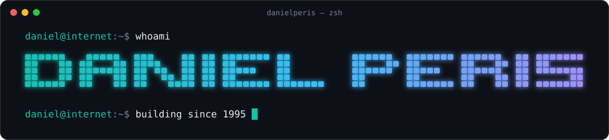

<h1 align="center">Hi, I'm Daniel 👋</h1>

  <b>Building things on the Internet since 1995.</b> 
  Entrepreneur in Barcelona and <b>100% self-taught</b>, now focused on <b>AI Search</b>.

  
  
  
  

---

### 🚀 Now

I'm building **[LLM Pulse](https://llmpulse.ai)**: it tracks how visible a brand is in AI answers (ChatGPT, Perplexity, Gemini, Google AI Overviews) — which prompts mention you, how you rank against competitors and which sources the models cite.

Search is changing faster than it has in 25 years, and I want brands to see what the AIs are saying about them.

### 🛠️ Side project

| | Project | What it is |
|---|---|---|
| 🍏 | **[WallaMac](https://github.com/danielperis/wallamac)** | macOS app that reads your Mac's full spec sheet (chip, RAM, SSD, GPU, battery health, maskable serial) and writes the listing to sell it second-hand. [Download](https://github.com/danielperis/wallamac/releases/latest) |

### 🧭 A short timeline

| Year | |
|:---:|---|
| **1983** | 👶 Born. Grew up surrounded by **computers and video game consoles**. |
| **1989** | Got my first computer: a **Commodore Amiga 500**. It was magic. ✨ |
| **1991** | Learned to program in **BASIC**. |
| **1995** | Got on the Internet for the first time and built my first web page with a plain text editor. |
| **1995** | Built my own **HTML editor** with Visual Basic. |
| **1997–2000** | Developed several **video games** with DIV Games Studio and DIV 2. |
| **1998** | Built a **LAN chat** for my computer science class, in Delphi (Pascal). |
| **2003** | Launched **ValenciaNight**, a social network in Valencia. Reached **10,000 registered users**. |
| **2009** | Launched **DimeQuien**, a web analytics SaaS for Tuenti. Got **60K registered users in one week**. It lived for one month, until Tuenti fixed the security flaw that made it possible. |
| **2010** | Launched **iPadizate**, the world's first Spanish-language iPad blog. Reached **2.5M visits/month** and was sold to **Difoosion** in 2015. |
| **2010** | Launched **Cantanding**, the world's first online karaoke built on the **YouTube API**, developed with [@grindcode](https://github.com/grindcode). Reached **1M visits/month** and ranked **#1 on Google US** for "karaoke" and "karaoke online", until it was removed from Google's index in 2015. |
| **2011** | 🎤 Started speaking at **SEO & growth conferences**. |
| **2013** | Founded **[PICKASO](https://pickaso.com)**, the first native ASO & app marketing agency in Spain and Europe. |
| **2013** | Started publishing my own **Android & iOS apps**: **150+ apps** published. |
| **2016** | 💍 Married **Miriam Peláez**. |
| **2017** | Launched **TheTool**, the first performance-based ASO tool. Sold to **AppRadar** in 2021. |
| **2023** | 👶 Our first son, **App1**, was born. |
| **2025** | AI Search & **[LLM Pulse](https://llmpulse.ai)**. |
| **2025** | 👶 Our second son, **App2**, was born. |

Along the way I've also built **micro-SaaS products, Chrome extensions, mobile games, websites monetized with AdSense and affiliate programs** and a long list of other digital products. Some of them I built, grew and **sold**.

### 🎤 Speaking & teaching

- **Speaker since 2011** at the main SEO, ASO and growth events and conferences in Spain, plus talks in **Berlin** and **London**.
- **Lecturer** at business schools, universities and master's programs.
- Guest at webinars and online events organized by **Apple, Google, Huawei, Samsung** and other big tech companies.

Husband, dad, entrepreneur. Barcelona 🇪🇸

